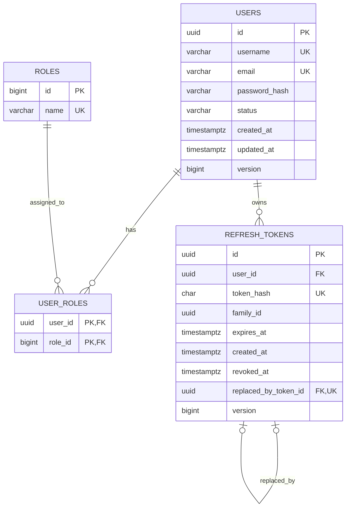

# Phân tích và thiết kế cơ sở dữ liệu User Service

## 1. Mục tiêu và phạm vi

Tài liệu này mô tả thiết kế dữ liệu mục tiêu cho `user-service` của ShopCore, bao gồm:

- Ranh giới dữ liệu mà User Service sở hữu.
- Mô hình quan hệ, kiểu dữ liệu, khóa và ràng buộc.
- Index theo các luồng truy vấn thực tế.
- Quy tắc vòng đời tài khoản và refresh token.
- Thiết kế lớp thực thể JPA và repository/transaction liên quan.
- So sánh schema hiện tại với các điểm nên hardening.
- Chiến lược migration, kiểm thử và lưu trữ dữ liệu.

Thiết kế dựa trên source hiện tại:

- PostgreSQL 17 ở môi trường runtime.
- Flyway quản lý schema; Hibernate dùng `ddl-auto=validate`.
- H2 PostgreSQL mode phục vụ integration test.
- Java `UUID` sinh tại application cho user và refresh token.
- Access token là JWT stateless, không lưu trong database.
- Refresh token là opaque token, database chỉ lưu SHA-256 hash.

## 2. Ranh giới dữ liệu

User Service là nguồn dữ liệu chuẩn cho:

- Tài khoản và credential đăng nhập.
- Trạng thái tài khoản.
- Role cấp hệ thống.
- Refresh token, token family, rotation và revoke.
- Hồ sơ tối thiểu hiện tại gồm `username` và `email`.

User Service không lưu:

- Access token JWT đã phát hành.
- Sản phẩm, tồn kho, đơn hàng hoặc dữ liệu nghiệp vụ của service khác.
- Quyền trên từng tài nguyên như `order:read-own` nếu chưa có yêu cầu RBAC chi tiết.
- Raw password hoặc raw refresh token.

Mỗi service phải có database riêng. Service khác chỉ tham chiếu `user_id` như một định danh logic; không tạo foreign key xuyên database/service.

## 3. Các quyết định thiết kế chính

| Chủ đề | Quyết định | Lý do |
|---|---|---|
| Database | PostgreSQL 17 | Phù hợp cấu hình runtime hiện tại, hỗ trợ tốt UUID, `timestamptz`, partial index và locking |
| Quản lý schema | Flyway là nguồn sự thật | Migration có phiên bản, review được; Hibernate chỉ validate mapping |
| ID của user/token | `UUID`, sinh tại application | Không lộ số lượng bản ghi, tạo ID trước khi persist, thuận tiện giữa các service |
| ID của role | `BIGINT IDENTITY` | Role là dữ liệu tham chiếu nhỏ, ổn định và được seed |
| Enum | `VARCHAR` + `CHECK` | Dễ đọc, dễ migration hơn PostgreSQL native enum, tương thích JPA `EnumType.STRING` |
| Thời gian | `TIMESTAMP WITH TIME ZONE` / Java `Instant` | Lưu một mốc UTC tuyệt đối, tránh phụ thuộc múi giờ máy chủ |
| Username/email | Lưu dạng canonical đã `trim` và lowercase | Unique constraint hoạt động nhất quán với login không phân biệt hoa thường |
| Password | Chỉ lưu encoded hash, `VARCHAR(255)` | Đủ cho BCrypt hiện tại và linh hoạt với Argon2/PBKDF2 sau này |
| Refresh token | Lưu SHA-256 hex, không lưu raw token | Database bị lộ không làm lộ ngay token có thể sử dụng |
| Concurrent update | Optimistic lock cho user, pessimistic lock khi rotate token | Tránh lost update hồ sơ và đảm bảo một refresh token chỉ rotate thành công một lần |

## 4. Mô hình quan hệ



Quan hệ:

- `users` và `roles`: nhiều-nhiều qua `user_roles`.
- `users` và `refresh_tokens`: một-nhiều.
- `refresh_tokens.replaced_by_token_id`: self-reference mô tả chuỗi rotation.
- `family_id` gom toàn bộ token sinh ra từ cùng một phiên đăng nhập; đây là correlation ID, không phải foreign key.

## 5. Quy ước chung

### 5.1. Tên và schema

- Tên bảng/cột dùng `snake_case`.
- Tên constraint/index phải có nghĩa và ổn định để dễ đọc lỗi production.
- Có thể dùng schema mặc định `public` trong MVP. Nếu một PostgreSQL instance chứa nhiều bounded context, nên dùng schema riêng như `identity`, nhưng vẫn không cho service khác đọc trực tiếp.

### 5.2. Nullability

- Mặc định cột nghiệp vụ là `NOT NULL`.
- Chỉ dùng nullable khi `NULL` mang nghĩa rõ ràng. Ví dụ `revoked_at IS NULL` nghĩa là chưa bị revoke.
- Không dùng chuỗi rỗng thay cho `NULL`.

### 5.3. Canonical identity

Trước khi ghi hoặc tìm kiếm, application thực hiện:

```text
canonical(value) = value.trim().toLowerCase(Locale.ROOT)
```

Database unique trên chính giá trị canonical. Nhờ đó `Alice`, ` alice ` và `ALICE` được coi là một username.

Thiết kế hiện tại không tách `display_username` và `normalized_username`. Điều này phù hợp MVP. Nếu sau này cần giữ cách viết hoa để hiển thị, bổ sung cột hiển thị riêng; không thay đổi ý nghĩa của cột canonical dùng đăng nhập.

## 6. Thiết kế chi tiết từng bảng

### 6.1. Bảng `users`

| Cột | Kiểu PostgreSQL | Null | Mặc định | Ý nghĩa |
|---|---|---:|---|---|
| `id` | `UUID` | Không | Application sinh | Định danh bất biến của user |
| `username` | `VARCHAR(50)` | Không | Không | Username canonical dùng đăng nhập/hiển thị MVP |
| `email` | `VARCHAR(254)` | Không | Không | Email canonical dùng đăng nhập |
| `password_hash` | `VARCHAR(255)` | Không | Không | Encoded password, không phải raw password |
| `status` | `VARCHAR(20)` | Không | `'ACTIVE'` nếu muốn đặt tại DB | `ACTIVE`, `LOCKED`, `DISABLED` |
| `created_at` | `TIMESTAMP WITH TIME ZONE` | Không | `CURRENT_TIMESTAMP` | Thời điểm tạo |
| `updated_at` | `TIMESTAMP WITH TIME ZONE` | Không | `CURRENT_TIMESTAMP` | Thời điểm cập nhật gần nhất |
| `version` | `BIGINT` | Không | `0` | Optimistic-lock version |

Khóa và ràng buộc đề xuất:

- Primary key: `pk_users (id)`.
- Unique: `uk_users_username (username)`.
- Unique: `uk_users_email (email)`.
- `username` phải lowercase, không có khoảng trắng đầu/cuối và khớp `^[a-z0-9._-]{3,50}$`.
- `email` phải lowercase, không có khoảng trắng đầu/cuối và dài không quá 254. Cú pháp email đầy đủ vẫn được validate ở application.
- `status IN ('ACTIVE', 'LOCKED', 'DISABLED')`.
- `version >= 0`.
- `updated_at >= created_at`.

Không cần index riêng cho `username` và `email` vì unique constraint đã tạo unique B-tree index. Không nên index `status` ở MVP vì độ chọn lọc thấp và chưa có truy vấn batch theo trạng thái.

Quy tắc nghiệp vụ:

- User mới luôn có `status = ACTIVE` và role `USER`; client không được tự gửi status/role.
- `LOCKED` và `DISABLED` đều không được login hoặc refresh.
- Đổi username/email phải đi qua cùng hàm canonical hóa như đăng ký/login.
- Kiểm tra `exists...` ở application chỉ giúp trả lỗi đẹp; unique constraint trong database mới là lớp bảo vệ cuối cùng trước race condition.
- Xóa user là thao tác quản trị nhạy cảm. MVP nên ưu tiên đổi sang `DISABLED`; nếu hard-delete thì role mapping và refresh token bị xóa theo cascade.

### 6.2. Bảng `roles`

| Cột | Kiểu PostgreSQL | Null | Mặc định | Ý nghĩa |
|---|---|---:|---|---|
| `id` | `BIGINT GENERATED BY DEFAULT AS IDENTITY` | Không | Identity | Khóa kỹ thuật |
| `name` | `VARCHAR(20)` | Không | Không | Tên role hệ thống |

Khóa và ràng buộc đề xuất:

- Primary key: `pk_roles (id)`.
- Unique: `uk_roles_name (name)`.
- Check: `name IN ('USER', 'ADMIN')` trong phạm vi MVP.

Seed bắt buộc và idempotent:

- `USER`: role mặc định cho tài khoản mới.
- `ADMIN`: role quản trị hệ thống.

Application không được phụ thuộc vào giá trị số cụ thể của `roles.id`; luôn tìm role theo `name`.

### 6.3. Bảng `user_roles`

| Cột | Kiểu PostgreSQL | Null | Ý nghĩa |
|---|---|---:|---|
| `user_id` | `UUID` | Không | FK tới `users.id` |
| `role_id` | `BIGINT` | Không | FK tới `roles.id` |

Khóa và ràng buộc đề xuất:

- Composite primary key: `(user_id, role_id)`, đồng thời ngăn gán trùng role.
- `user_id -> users(id) ON DELETE CASCADE`.
- `role_id -> roles(id) ON DELETE RESTRICT`.
- Index `idx_user_roles_role_id (role_id)` để hỗ trợ truy vấn ngược từ role sang user; primary key chỉ tối ưu tốt cho prefix `user_id`.

Không cần tạo `UserRoleEntity` riêng khi bảng nối chỉ có hai foreign key. Nếu sau này cần `assigned_at`, `assigned_by` hoặc trạng thái gán role, phải nâng bảng nối thành entity độc lập với embedded/composite key.

### 6.4. Bảng `refresh_tokens`

| Cột | Kiểu PostgreSQL | Null | Mặc định | Ý nghĩa |
|---|---|---:|---|---|
| `id` | `UUID` | Không | Application sinh | Định danh record token |
| `user_id` | `UUID` | Không | Không | User sở hữu token |
| `token_hash` | `CHAR(64)` | Không | Không | SHA-256 dạng lowercase hex của raw token |
| `family_id` | `UUID` | Không | Không | Định danh phiên/token family |
| `expires_at` | `TIMESTAMP WITH TIME ZONE` | Không | Không | Thời điểm hết hạn tuyệt đối |
| `created_at` | `TIMESTAMP WITH TIME ZONE` | Không | `CURRENT_TIMESTAMP` | Thời điểm phát hành |
| `revoked_at` | `TIMESTAMP WITH TIME ZONE` | Có | `NULL` | Thời điểm thu hồi hoặc rotate |
| `replaced_by_token_id` | `UUID` | Có | `NULL` | Token kế tiếp trong chuỗi rotation |
| `version` | `BIGINT` | Không | `0` | Optimistic-lock fallback/audit concurrency |

Khóa và ràng buộc đề xuất:

- Primary key: `pk_refresh_tokens (id)`.
- Unique: `uk_refresh_tokens_hash (token_hash)`.
- Unique: `uk_refresh_tokens_replacement (replaced_by_token_id)`; một token mới chỉ được là hậu duệ trực tiếp của tối đa một token cũ.
- FK `user_id -> users(id) ON DELETE CASCADE`.
- Self FK `replaced_by_token_id -> refresh_tokens(id) ON DELETE SET NULL`; giúp hard-delete user/cleanup không bị chặn bởi chuỗi self-reference.
- `token_hash` phải đúng 64 ký tự lowercase hex: `^[0-9a-f]{64}$`.
- `expires_at > created_at`.
- `revoked_at IS NULL OR revoked_at >= created_at`.
- `replaced_by_token_id IS NULL OR revoked_at IS NOT NULL`.
- `replaced_by_token_id IS NULL OR replaced_by_token_id <> id`.
- `version >= 0`.

Index đề xuất:

| Index | Mục đích |
|---|---|
| Unique index của `token_hash` | Login/refresh/logout tra token bằng hash |
| `idx_refresh_tokens_user_created (user_id, created_at DESC)` | Thu hồi/tra cứu phiên của một user, cleanup hoặc admin support |
| `idx_refresh_tokens_family_active (family_id) WHERE revoked_at IS NULL` | Revoke toàn bộ token còn active khi phát hiện replay |
| `idx_refresh_tokens_expires_at (expires_at)` | Cleanup token/family đã hết hạn |

Không lưu trạng thái `ACTIVE`, `ROTATED`, `REVOKED`, `EXPIRED` thành cột riêng vì có thể suy ra:

| Trạng thái logic | Điều kiện |
|---|---|
| `ACTIVE` | `revoked_at IS NULL AND expires_at > now()` |
| `EXPIRED` | `expires_at <= now()` |
| `ROTATED` | `revoked_at IS NOT NULL AND replaced_by_token_id IS NOT NULL` |
| `REVOKED` | `revoked_at IS NOT NULL AND replaced_by_token_id IS NULL` |

Lưu cả enum trạng thái và các timestamp trên sẽ tạo hai nguồn sự thật và dễ phát sinh dữ liệu mâu thuẫn.

## 7. DDL mục tiêu tham khảo

DDL dưới đây thể hiện thiết kế mục tiêu cho PostgreSQL. Khi triển khai phải đặt trong Flyway migration mới, không sửa migration đã chạy ở môi trường dùng chung.

```sql
CREATE TABLE roles (
    id BIGINT GENERATED BY DEFAULT AS IDENTITY,
    name VARCHAR(20) NOT NULL,
    CONSTRAINT pk_roles PRIMARY KEY (id),
    CONSTRAINT uk_roles_name UNIQUE (name),
    CONSTRAINT ck_roles_name CHECK (name IN ('USER', 'ADMIN'))
);

CREATE TABLE users (
    id UUID NOT NULL,
    username VARCHAR(50) NOT NULL,
    email VARCHAR(254) NOT NULL,
    password_hash VARCHAR(255) NOT NULL,
    status VARCHAR(20) NOT NULL DEFAULT 'ACTIVE',
    created_at TIMESTAMP WITH TIME ZONE NOT NULL DEFAULT CURRENT_TIMESTAMP,
    updated_at TIMESTAMP WITH TIME ZONE NOT NULL DEFAULT CURRENT_TIMESTAMP,
    version BIGINT NOT NULL DEFAULT 0,
    CONSTRAINT pk_users PRIMARY KEY (id),
    CONSTRAINT uk_users_username UNIQUE (username),
    CONSTRAINT uk_users_email UNIQUE (email),
    CONSTRAINT ck_users_username_canonical CHECK (
        username = lower(btrim(username))
        AND username ~ '^[a-z0-9._-]{3,50}$'
    ),
    CONSTRAINT ck_users_email_canonical CHECK (
        email = lower(btrim(email))
        AND char_length(email) BETWEEN 3 AND 254
    ),
    CONSTRAINT ck_users_status CHECK (status IN ('ACTIVE', 'LOCKED', 'DISABLED')),
    CONSTRAINT ck_users_version CHECK (version >= 0),
    CONSTRAINT ck_users_timestamps CHECK (updated_at >= created_at)
);

CREATE TABLE user_roles (
    user_id UUID NOT NULL,
    role_id BIGINT NOT NULL,
    CONSTRAINT pk_user_roles PRIMARY KEY (user_id, role_id),
    CONSTRAINT fk_user_roles_user
        FOREIGN KEY (user_id) REFERENCES users (id) ON DELETE CASCADE,
    CONSTRAINT fk_user_roles_role
        FOREIGN KEY (role_id) REFERENCES roles (id) ON DELETE RESTRICT
);

CREATE INDEX idx_user_roles_role_id ON user_roles (role_id);

CREATE TABLE refresh_tokens (
    id UUID NOT NULL,
    user_id UUID NOT NULL,
    token_hash CHAR(64) NOT NULL,
    family_id UUID NOT NULL,
    expires_at TIMESTAMP WITH TIME ZONE NOT NULL,
    created_at TIMESTAMP WITH TIME ZONE NOT NULL DEFAULT CURRENT_TIMESTAMP,
    revoked_at TIMESTAMP WITH TIME ZONE,
    replaced_by_token_id UUID,
    version BIGINT NOT NULL DEFAULT 0,
    CONSTRAINT pk_refresh_tokens PRIMARY KEY (id),
    CONSTRAINT uk_refresh_tokens_hash UNIQUE (token_hash),
    CONSTRAINT uk_refresh_tokens_replacement UNIQUE (replaced_by_token_id),
    CONSTRAINT fk_refresh_tokens_user
        FOREIGN KEY (user_id) REFERENCES users (id) ON DELETE CASCADE,
    CONSTRAINT fk_refresh_tokens_replacement
        FOREIGN KEY (replaced_by_token_id) REFERENCES refresh_tokens (id) ON DELETE SET NULL,
    CONSTRAINT ck_refresh_tokens_hash CHECK (token_hash ~ '^[0-9a-f]{64}$'),
    CONSTRAINT ck_refresh_tokens_expiry CHECK (expires_at > created_at),
    CONSTRAINT ck_refresh_tokens_revoked_at CHECK (
        revoked_at IS NULL OR revoked_at >= created_at
    ),
    CONSTRAINT ck_refresh_tokens_replacement_state CHECK (
        replaced_by_token_id IS NULL OR revoked_at IS NOT NULL
    ),
    CONSTRAINT ck_refresh_tokens_not_self_replaced CHECK (
        replaced_by_token_id IS NULL OR replaced_by_token_id <> id
    ),
    CONSTRAINT ck_refresh_tokens_version CHECK (version >= 0)
);

CREATE INDEX idx_refresh_tokens_user_created
    ON refresh_tokens (user_id, created_at DESC);

CREATE INDEX idx_refresh_tokens_family_active
    ON refresh_tokens (family_id)
    WHERE revoked_at IS NULL;

CREATE INDEX idx_refresh_tokens_expires_at
    ON refresh_tokens (expires_at);
```

Lưu ý: toán tử regex `~` và partial index là PostgreSQL-specific. Test H2 cần migration/test strategy tương thích hoặc chạy persistence test quan trọng bằng PostgreSQL Testcontainers để tránh sai khác dialect.

## 8. Quy tắc toàn vẹn không thể biểu diễn hoàn toàn bằng CHECK

Một số invariant cần application service hoặc trigger. Thiết kế này ưu tiên application service để logic dễ test và không ẩn trong database:

- Token thay thế phải thuộc cùng `user_id` và `family_id` với token cũ.
- Mỗi family chỉ nên có tối đa một token active sau khi transaction rotate commit.
- User phải luôn có ít nhất một role trong luồng nghiệp vụ thông thường.
- User mới phải có role `USER`.
- Chỉ account `ACTIVE` mới được phát token mới.
- `updated_at` phải được cập nhật ở mọi thay đổi user.

Các invariant này được giữ bằng transaction, locking và test. Không nên dùng trigger trong MVP trừ khi xuất hiện nhiều writer ngoài User Service; về nguyên tắc không được có writer khác.

## 9. Vòng đời refresh token và transaction

### 9.1. Phát family mới

1. Xác thực username/email, password và `users.status = ACTIVE`.
2. Sinh `family_id` mới.
3. Sinh 32 byte ngẫu nhiên bằng CSPRNG và encode Base64 URL-safe làm raw token.
4. Hash raw token bằng SHA-256 thành 64 ký tự lowercase hex.
5. Insert `refresh_tokens`; chỉ raw token được trả qua cookie bảo mật.

### 9.2. Rotate

Toàn bộ thao tác phải nằm trong một transaction:

1. Hash token client gửi lên.
2. Đọc row theo `token_hash` bằng `SELECT ... FOR UPDATE`/`PESSIMISTIC_WRITE`.
3. Nếu token đã rotate, coi là replay và revoke mọi token active cùng `family_id`.
4. Nếu token đã expire, revoke record và từ chối.
5. Nếu user không còn `ACTIVE`, revoke record và từ chối.
6. Insert token mới với cùng `user_id` và `family_id`.
7. Gán token cũ `revoked_at = now`, `replaced_by_token_id = new.id`.
8. Commit rồi mới trả raw token mới.

Pessimistic row lock là cơ chế chính bảo đảm hai request refresh đồng thời chỉ có một request thành công. `version` vẫn hữu ích để phát hiện cập nhật ngoài luồng hoặc làm lớp bảo vệ bổ sung.

### 9.3. Logout và replay

- Logout idempotent: token tồn tại thì đặt `revoked_at` nếu chưa có; token không tồn tại vẫn coi là hoàn thành.
- Token cũ có `replaced_by_token_id` mà được dùng lại là dấu hiệu replay; revoke toàn family.
- Bulk update revoke family cần chạy trong transaction và cập nhật chỉ các row `revoked_at IS NULL`.

## 10. Thiết kế lớp thực thể JPA

### 10.1. `UserEntity`

Mapping đề xuất:

```java
@Entity
@Table(name = "users")
public class UserEntity {
    @Id
    private UUID id;

    @Column(nullable = false, unique = true, length = 50)
    private String username;

    @Column(nullable = false, unique = true, length = 254)
    private String email;

    @Column(name = "password_hash", nullable = false, length = 255)
    private String passwordHash;

    @Enumerated(EnumType.STRING)
    @Column(nullable = false, length = 20)
    private UserStatus status;

    @ManyToMany(fetch = FetchType.LAZY)
    @JoinTable(
        name = "user_roles",
        joinColumns = @JoinColumn(name = "user_id"),
        inverseJoinColumns = @JoinColumn(name = "role_id")
    )
    private Set<RoleEntity> roles = new HashSet<>();

    @Column(name = "created_at", nullable = false, updatable = false)
    private Instant createdAt;

    @Column(name = "updated_at", nullable = false)
    private Instant updatedAt;

    @Version
    @Column(nullable = false)
    private long version;
}
```

Yêu cầu hành vi:

- Constructor nghiệp vụ tạo UUID, nhận identity đã normalize, password hash và role mặc định.
- Không cung cấp public setter cho `id`, `passwordHash`, `status`, `roles`, timestamps hoặc `version`.
- Các method có ý nghĩa nghiệp vụ: `updateProfile`, `changePassword`, `lock`, `disable`, `activate`, `grantRole`, `revokeRole` khi use case xuất hiện.
- `roles` nên để LAZY và repository dùng `@EntityGraph` tại query cần role. Source hiện tại dùng EAGER; vẫn chạy đúng với chỉ hai role nhưng dễ tải thừa và khó kiểm soát query khi mô hình lớn hơn.
- Không cascade `REMOVE` từ user sang role; role là dữ liệu tham chiếu dùng chung.

### 10.2. `RoleEntity`

```java
@Entity
@Table(name = "roles")
public class RoleEntity {
    @Id
    @GeneratedValue(strategy = GenerationType.IDENTITY)
    private Long id;

    @Enumerated(EnumType.STRING)
    @Column(nullable = false, unique = true, length = 20)
    private RoleName name;
}
```

Role được seed bằng migration, không tạo tùy ý qua public API. `RoleName` và `ck_roles_name` phải thay đổi cùng một migration/release khi thêm role mới.

### 10.3. `RefreshTokenEntity`

```java
@Entity
@Table(name = "refresh_tokens")
public class RefreshTokenEntity {
    @Id
    private UUID id;

    @ManyToOne(fetch = FetchType.LAZY, optional = false)
    @JoinColumn(name = "user_id", nullable = false)
    private UserEntity user;

    @Column(name = "token_hash", nullable = false, unique = true, length = 64)
    private String tokenHash;

    @Column(name = "family_id", nullable = false)
    private UUID familyId;

    @Column(name = "expires_at", nullable = false)
    private Instant expiresAt;

    @Column(name = "created_at", nullable = false, updatable = false)
    private Instant createdAt;

    @Column(name = "revoked_at")
    private Instant revokedAt;

    @Column(name = "replaced_by_token_id")
    private UUID replacedByTokenId;

    @Version
    @Column(nullable = false)
    private long version;
}
```

Giữ `replacedByTokenId` là UUID scalar thay vì map self-relation là lựa chọn hợp lý cho MVP:

- Luồng rotate chỉ cần ghi ID, không cần traverse object graph.
- Tránh vòng tham chiếu và fetch ngoài ý muốn.
- Foreign key ở database vẫn bảo đảm token đích tồn tại.

Các method hành vi tối thiểu: `isActiveAt(now)`, `revoke(now)`, `replaceWith(replacementId, now)`. Method phải idempotent nơi phù hợp và không cho thay đổi `user`, `familyId`, `tokenHash`, `createdAt` sau khi tạo.

### 10.4. Không map collection token vào `UserEntity`

Không cần `UserEntity.refreshTokens` trong MVP. Token thường được truy vấn bằng hash/family và có thể tăng rất nhiều; map collection hai chiều dễ gây tải dữ liệu lớn, cascade nhầm và vấn đề serialization. Quan hệ một chiều `RefreshTokenEntity -> UserEntity` là đủ.

## 11. Repository và query contract

### `UserRepository`

- `existsByUsername`, `existsByEmail` để fail fast, nhưng luôn bắt unique violation khi insert/update.
- `findByUsernameOrEmail(login, login)` cho login bằng canonical identity.
- Query trả user cho login/JWT phải fetch roles bằng `@EntityGraph` hoặc join fetch.
- Update profile dựa trên `@Version`; concurrent update thua phải trả lỗi conflict phù hợp, không ghi đè im lặng.

### `RoleRepository`

- `findByName(RoleName)`; không tìm theo ID hard-coded.

### `RefreshTokenRepository`

- `findByTokenHashForUpdate(hash)` dùng pessimistic write lock và fetch user + roles cần phát JWT.
- `revokeActiveByFamilyId(familyId, revokedAt)` là bulk update có điều kiện `revokedAt IS NULL`.
- Nên bổ sung query cleanup theo `expiresAt` và retention cutoff khi triển khai scheduled cleanup.
- Bulk JPQL update phải clear/refresh persistence context để tránh entity đang giữ state cũ.

## 12. Đối chiếu với schema/source hiện tại

Schema V1 và entity hiện tại đã đáp ứng các yêu cầu cốt lõi:

- Đủ bốn bảng và đúng quan hệ.
- Unique username/email/token hash.
- FK và cascade khi xóa user.
- `UserEntity` có optimistic locking.
- Refresh rotation dùng pessimistic lock.
- Token family và replacement lineage đã được lưu.
- Password và refresh token chỉ lưu dạng hash.

Các điểm nên bổ sung bằng migration mới:

| Mức | Hiện tại | Khuyến nghị |
|---|---|---|
| Cao | `password_hash VARCHAR(100)` | Nâng lên `VARCHAR(255)` để không phụ thuộc lâu dài vào BCrypt |
| Cao | Database chưa ép username/email canonical | Thêm CHECK sau khi audit/chuẩn hóa dữ liệu cũ |
| Cao | Refresh token chưa có temporal/state CHECK | Thêm expiry, revoked, replacement và self-reference CHECK |
| Trung bình | `roles.name` chưa có CHECK | Đồng bộ tập role DB với `RoleName` |
| Trung bình | `replaced_by_token_id` chưa unique | Bảo đảm một token mới không có nhiều predecessor |
| Trung bình | Thiếu index reverse cho `user_roles.role_id` | Thêm index nếu có truy vấn user theo role/admin use case |
| Trung bình | Index refresh token mới chỉ có `user_id`, `family_id` | Chuyển sang index theo query/cleanup và partial active-family index |
| Trung bình | Chưa định nghĩa retention/cleanup | Chốt thời gian giữ token đã expire/revoke và xóa theo batch |
| Thấp | `roles` đang EAGER trong entity | Đổi LAZY, fetch rõ ràng bằng entity graph tại use case cần role |

Không sửa `V1__create_identity_schema.sql` nếu migration đã được áp dụng ở bất kỳ môi trường dùng chung nào. Tạo `V2__harden_identity_schema.sql` và xử lý dữ liệu cũ trước khi bật constraint mới.

## 13. Kế hoạch migration đề xuất

1. Audit dữ liệu vi phạm: username/email không canonical, token hash sai format, timestamp bất hợp lệ, duplicate replacement.
2. Backup/snapshot database trước migration production.
3. Nâng `password_hash` lên `VARCHAR(255)`; thay đổi này không làm mất dữ liệu.
4. Chuẩn hóa username/email trong transaction có kiểm tra collision. Nếu `Alice` và `alice` cùng tồn tại, phải xử lý nghiệp vụ trước khi lowercase.
5. Thêm constraint ở trạng thái an toàn. PostgreSQL có thể dùng `NOT VALID` rồi `VALIDATE CONSTRAINT` cho bảng lớn để giảm thời gian lock.
6. Tạo index phù hợp; production lớn có thể dùng `CREATE INDEX CONCURRENTLY` trong migration không transaction riêng.
7. Cập nhật entity mapping (`passwordHash.length`, fetch strategy) cùng release.
8. Chạy integration test trên PostgreSQL thật/Testcontainers, sau đó smoke test register/login/refresh/logout/profile.

## 14. Retention và cleanup

Refresh token là dữ liệu bảo mật có tốc độ tăng liên tục. Cần scheduled cleanup theo batch, ví dụ:

- Giữ token active đến `expires_at`.
- Giữ token expired/revoked thêm 30 ngày để hỗ trợ điều tra replay/audit cơ bản.
- Xóa theo toàn family khi toàn bộ token trong family đã hết hạn và vượt retention cutoff.
- Mỗi batch có giới hạn, ví dụ 1.000-10.000 row, để tránh transaction dài và table bloat.
- Sau khi cleanup lớn, theo dõi autovacuum thay vì chạy `VACUUM FULL` tự động.

Nếu có yêu cầu audit pháp lý, không kéo dài vô hạn việc lưu token hash. Nên phát security event đã tối giản sang hệ thống audit riêng, có retention rõ ràng.

## 15. Bảo mật dữ liệu

- Không log `password`, `password_hash`, raw refresh token, `token_hash` đầy đủ hoặc JWT.
- Tài khoản kết nối User Service chỉ có quyền trên database/schema của chính service.
- Không cho BI/reporting hoặc service khác đọc trực tiếp bảng credential.
- Backup phải được mã hóa và có chính sách retention/xóa.
- Raw refresh token chỉ tồn tại ngắn trong memory và secure HttpOnly cookie.
- SHA-256 phù hợp cho refresh token vì đầu vào là 256-bit random secret; password bắt buộc dùng password encoder chậm như BCrypt/Argon2, không dùng SHA-256 trực tiếp.
- Không trả entity trực tiếp qua API; luôn dùng DTO không chứa hash và field nội bộ.

## 16. Kiểm thử bắt buộc

### Migration và mapping

- Flyway migrate thành công từ database rỗng.
- Hibernate `validate` pass trên PostgreSQL.
- Enum Java khớp CHECK constraint và seed role.
- Mapping `Instant <-> timestamptz`, `UUID`, `@Version` đúng.

### Constraint

- Không thể insert trùng username, email hoặc token hash.
- Không thể insert username/email không canonical sau khi bật CHECK.
- Không thể insert status/role ngoài tập cho phép.
- Không thể insert token có expiry trước thời điểm tạo.
- Không thể gán replacement cho token chưa revoke hoặc tự trỏ chính nó.
- Xóa user cascade đúng vào `user_roles`, `refresh_tokens`; không xóa role dùng chung.

### Transaction và concurrency

- Hai request đăng ký cùng username/email: chỉ một request thành công.
- Hai update cùng version: một update bị optimistic-lock conflict.
- Hai refresh đồng thời cùng token: chỉ một request thành công.
- Dùng lại token đã rotate: toàn family active bị revoke.
- Logout lặp lại không gây lỗi.
- Account `LOCKED`/`DISABLED` không phát refresh/access token mới.

### Query/index

- Dùng `EXPLAIN (ANALYZE, BUFFERS)` trên dữ liệu đủ lớn cho lookup token hash, revoke family và cleanup expiry.
- Kiểm tra không xuất hiện N+1 khi load user cùng roles để phát JWT.

## 17. Phần chưa đưa vào MVP

Chưa tạo bảng cho các chức năng sau vì source và contract hiện tại chưa yêu cầu:

- Email verification token.
- Password reset token và lịch sử mật khẩu.
- MFA/TOTP/WebAuthn.
- Social identity/provider account.
- Permission động ngoài `USER`/`ADMIN`.
- Device/session metadata như IP, user-agent, tên thiết bị.
- Access-token blacklist.
- Audit log đầy đủ.

Khi có use case thật, các chức năng này nên được thiết kế bằng bảng riêng thay vì thêm nhiều cột nullable vào `users` hoặc `refresh_tokens`.

## 18. Kết luận

Mô hình bốn bảng hiện tại là phù hợp cho MVP và đã có nền tảng concurrency/security tốt. Thiết kế mục tiêu không cần mở rộng domain ngay, mà tập trung hardening các điểm database phải chịu trách nhiệm: uniqueness, canonical identity, enum, tính hợp lệ thời gian, lineage của refresh token, index theo query và retention.

Nguồn sự thật cuối cùng được phân chia rõ:

```text
Flyway migration  = cấu trúc, kiểu dữ liệu, FK, UNIQUE, CHECK, index và seed
JPA entity         = mapping và hành vi của aggregate
Application service = invariant liên bảng, transaction, locking và authorization
Database           = lớp bảo vệ cuối cùng trước race condition/dữ liệu sai
```
